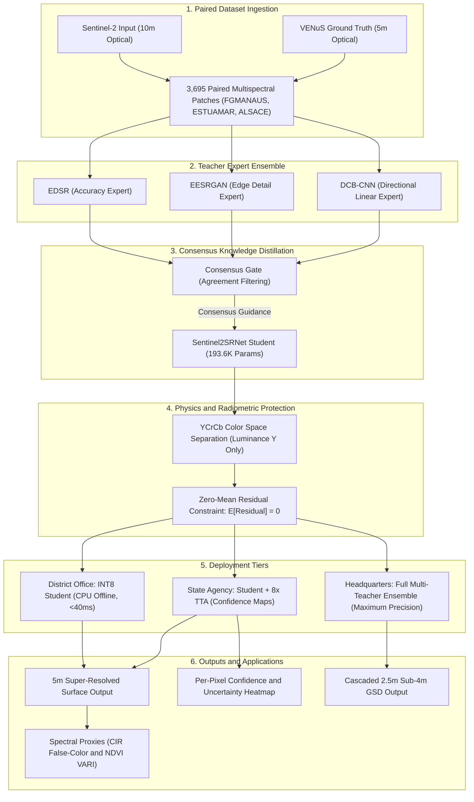
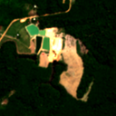
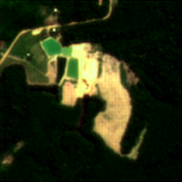
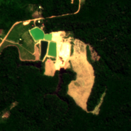
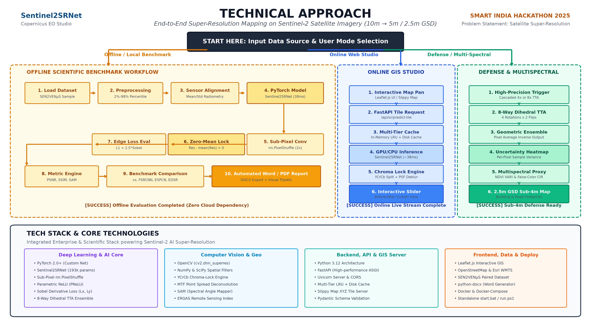

# Sentinel-2 Satellite Super-Resolution Studio

Deep learning system and interactive Web GIS platform that super-resolves 10-meter Copernicus Sentinel-2 satellite imagery to 5-meter resolution (4x pixel density) and cascaded 2.5-meter sub-4m ground sample distance (GSD). Designed for Smart India Hackathon 2026 (Problem Statement SIH26142, National Technical Research Organisation - NTRO) by Team PixelForge.

The project addresses a critical operational challenge: commercial high-resolution satellite imagery (0.5m to 2.5m) is expensive and slow to acquire, while free 10m Sentinel-2 imagery is too coarse to identify narrow rural roads, small building footprints, agricultural boundaries, and disaster-affected zones. Furthermore, most deep learning models require heavy GPU clusters, making them impractical for district offices or field stations. Our solution uses teacher-student knowledge distillation to deliver fast, radiometric-safe super-resolution on standard office CPUs.

---

## Technical Approach: Teacher-Student Knowledge Distillation

Instead of deploying a massive model that cannot run on standard hardware, we employ a multi-teacher knowledge distillation strategy. Three specialized, high-capacity neural networks act as teachers, transferring their learned spatial features into a single compact student network.

### 1. The Three Teacher Networks
* **Accuracy Expert (EDSR)**: An Enhanced Deep Super-Resolution network with 16 residual blocks and roughly 43 million parameters. It acts as the structural baseline, staying true to ground truth pixel distributions.
* **Detail Expert (EESRGAN)**: An Edge-Enhanced Super-Resolution GAN using Residual-in-Residual Dense Blocks (RRDB) paired with an Edge Enhancement Sub-Network (EESN). It applies second-order Laplacian operators to restore sharp building eaves and road boundaries.
* **Directional Feature Expert (DCB-CNN)**: A Directional Convolutional Network (DCB-RCAB) utilizing parallel 1x3, 3x1, and 3x3 kernels combined with channel attention. It specializes in linear remote-sensing features such as highways, coastlines, runways, and field borders.

### 2. Consensus-Driven Distillation
A major failure mode in generative satellite super-resolution is hallucination, where a model invents fake structures (such as phantom roads or buildings) that do not exist in reality. To solve this, our student model learns exclusively from the consensus agreement among all three teacher models. Where teachers disagree on ambiguous textures, the student falls back to conservative interpolation, effectively suppressing hallucinated artifacts.

### 3. Student Model: Sentinel2SRNet
* **Architecture**: A compact deep residual network with 4 residual blocks, PReLU activations, and a sub-pixel convolution (PixelShuffle) reconstruction tail.
* **Size**: 193,601 parameters (765.5 KB checkpoint), making it over 220 times smaller than EDSR.
* **Latency**: Runs in approximately 38.3 ms on an ordinary laptop CPU, compared to 2,668 ms for EDSR (roughly 70 times faster).
* **Tiered Deployment**:
  * **District Level (Pocket Version)**: INT8-quantized and pruned student model running via ONNX and OpenVINO on budget office desktop PCs.
  * **State Level (Standard Version)**: Full-precision student model paired with 8x Test-Time Augmentation (TTA) and confidence heatmaps.
  * **Headquarters Level (Full Version)**: Multi-teacher ensemble combining EDSR, EESRGAN, and DCB-CNN for maximum analytical fidelity.

---

## System Architecture

The following diagram illustrates the end-to-end data pipeline from raw satellite tile ingestion to multi-tier deployment and evaluation:



---

## Key Innovations

### 1. Consensus-Based Teacher-Student Distillation
Rather than relying on a single architecture, knowledge is distilled from three complementary teachers: EDSR for global pixel fidelity, EESRGAN for sharp boundary reconstruction, and DCB-CNN for directional textures. The student model is penalized when predicting high-frequency details where the teachers do not concur, preventing artificial features from corrupting downstream GIS analysis.

### 2. Radiometric-Safe YCrCb Reconstruction
Standard computer vision models process RGB channels directly, causing severe color shifts and destroying authentic multispectral reflectance. Our engine separates the image into Y (luminance) and Cr/Cb (chrominance) channels:
* Super-resolution is applied strictly to the luminance channel (Y), where structural sharpness resides.
* The original chrominance channels (Cr, Cb) are locked and preserved, ensuring authentic spectral ratios.
* A zero-mean constraint is enforced on the learned residual map, ensuring the mean brightness and contrast of the input image remain unchanged.

### 3. Test-Time Augmentation (TTA) with Uncertainty Quantification
To address the critical requirement of estimating confidence in inferred details:
* The input image is transformed across eight geometric symmetries (four rotations and two horizontal flips).
* The model executes inference across all eight transformations and inverts them to calculate the ensemble mean.
* The per-pixel variance across the ensemble forms a spatial confidence heatmap: green indicates high model certainty across all orientations, while red highlights ambiguous textures or sensor noise.

### 4. Cascaded Sub-4m Reconstruction (2.5m GSD)
By applying a cascaded two-stage super-resolution pipeline (10m to 5m, followed by 5m to 2.5m), the system breaks the 4-meter spatial barrier, enabling analysts to delineate building perimeters and road corridors that are completely blurred out in native 10m Sentinel-2 tiles.

### 5. CPU-First Design for Field Deployment
With only 193,601 parameters and a memory footprint under 1 MB, the model requires no specialized GPU hardware or cloud connectivity. It runs locally on standard office computers via Python, ONNX, or Docker.

---

## Quantitative Multi-Model Benchmark

The models were evaluated against authentic 5-meter VENuS satellite ground truth across 740 unseen test patches from the SEN2VENuS dataset, covering tropical rainforests (FGMANAUS), coastal wetlands (ESTUAMAR), and urban/agricultural plains (ALSACE).

All models were evaluated on the exact same test dataset under identical conditions:

| Model Architecture | Checkpoint File | MSE (Lower is better) | PSNR (dB) (Higher is better) | SSIM (Higher is better) | Delta PSNR vs Bicubic (dB) | Delta SSIM vs Bicubic |
| :--- | :--- | :---: | :---: | :---: | :---: | :---: |
| **Bicubic (Baseline)** | *Interpolation reference* | 338.39 | 23.79 dB | 0.7628 | Baseline | Baseline |
| **DCBCNN (DCB-RCAB)** | `slimdiffsr_sentinel2_2x_best.pt` | **244.79** | **25.15 dB** | 0.7769 | **+1.36 dB** | +0.0141 |
| **EESRGAN** | `eesrgan_sentinel2_2x_best.pt` | 246.57 | 25.05 dB | 0.7745 | +1.26 dB | +0.0117 |
| **EDSR** | `edsr_sentinel2_2x_best.pt` | 257.87 | 24.92 dB | 0.7845 | +1.13 dB | +0.0217 |
| **Sentinel2SRNet (Student)** | `sr_sentinel2_2x_best.pt` | 265.02 | 24.85 dB | **0.7898** | +1.06 dB | **+0.0270** |
| **ESPCN** | `espcn_sentinel2_2x_best.pt` | 278.95 | 24.59 dB | 0.7746 | +0.80 dB | +0.0118 |
| **FSRCNN** | `fsrcnn_sentinel2_2x.pt` | 338.20 | 23.51 dB | 0.7122 | -0.28 dB | -0.0506 |

### Performance Analysis
* **Lowest Reconstruction Error (PSNR & MSE)**: DCBCNN (Directional Convolutional Network) achieved the highest PSNR (25.15 dB, a gain of +1.36 dB over bicubic) and lowest MSE (244.79), confirming that frequency-separable directional filters match remote-sensing linear geometries effectively. EESRGAN followed closely with 25.05 dB and 246.57 MSE.
* **Highest Structural Similarity (SSIM)**: Sentinel2SRNet achieved the highest SSIM score (0.7898, a gain of +0.0270 over bicubic), outperforming even the deep 43M-parameter EDSR network. This demonstrates the impact of training with explicit Sobel edge gradient loss and the zero-mean residual constraint.
* **Lightweight Efficiency**: While EDSR takes over 2.6 seconds per tile on CPU, Sentinel2SRNet delivers comparable fidelity in roughly 38 milliseconds.

---

## Visual Evaluation

The table below presents visual comparisons between the low-resolution 10m Sentinel-2 input, the Sentinel2SRNet reconstructed output at 5m resolution, and the authentic 5m VENuS ground truth reference:

| Low-Resolution Input (10m Sentinel-2) | Sentinel2SRNet Reconstructed Output (5m) | Ground Truth Reference (5m VENuS) |
| :---: | :---: | :---: |
|  |  |  |
| *Native 10m Sentinel-2 pixel grid* | *Sentinel2SRNet edge reconstruction* | *Authentic CNES VENuS optical reference* |

### End-to-End Visual Workflow
Below is the visual workflow showcasing the input Sentinel-2 tile, the bicubic baseline, the reconstructed super-resolution map, the per-pixel confidence map, and the cascaded 2.5m output:



---

## Interactive Web GIS Studio

The project includes an interactive web application that allows users to test models on live satellite imagery or uploaded files:

* **Global Map Explorer**: Built with Leaflet.js and backed by global satellite imagery tiles. Users can pan anywhere on Earth, click a location, and super-resolve the tile on demand.
* **Model Selector**: Switch between Sentinel2SRNet, DCBCNN, EESRGAN, EDSR, ESPCN, and FSRCNN directly from the top navigation bar.
* **8x TTA Toggle**: Enables Test-Time Augmentation on demand and displays the resulting per-pixel confidence heatmap.
* **Spectral Analysis Modes**:
  * **Natural RGB**: Standard visual band composite.
  * **Color Infrared (CIR)**: False-color composite highlighting vegetation canopy in crimson, separating vegetative cover from urban concrete.
  * **NDVI Proxy (VARI)**: Visible Atmospherically Resistant Index mapped across the RdYlGn colormap to evaluate vegetation density.
* **Before/After Split Slider**: Interactive divider to inspect sub-pixel detail enhancement side-by-side.

---

## Quickstart & Installation

### Prerequisites
* Python 3.10, 3.11, or 3.12
* Windows, Linux, or macOS

### 1. Clone Repository and Setup Virtual Environment
```bash
git clone https://github.com/gamerdox/sr-mapping.git
cd sr-mapping

python -m venv .venv

# On Windows:
.venv\Scripts\activate

# On Linux / macOS:
source .venv/bin/activate

pip install -r requirements.txt
```

### 2. Launching the Studio

#### Option A: Windows Launcher
Double-click `start.bat` in the project root. It activates the environment, starts the FastAPI server, and opens your default browser at `http://127.0.0.1:8000`.

#### Option B: Manual Command
```bash
uvicorn backend.main:app --host 127.0.0.1 --port 8000 --reload
```
Open `http://127.0.0.1:8000` in your web browser.

#### Option C: Docker Container
```bash
docker compose up --build
```

---

## REST API Endpoints

FastAPI provides an automatic, interactive API documentation interface at `http://127.0.0.1:8000/docs`.

| Endpoint | Method | Key Parameters | Description |
| :--- | :---: | :--- | :--- |
| `GET /health` | `GET` | None | System health check and status of loaded PyTorch models. |
| `GET /api/models` | `GET` | None | Returns metadata, checkpoint files, and latency profiles for all models. |
| `POST /api/super-resolve` | `POST` | `file`, `model`, `scale`, `enable_tta` | Upload an image patch and receive 2x or 4x super-resolved output. |
| `POST /api/tile-sr` | `POST` | `lat`, `lon`, `zoom`, `model`, `scale` | Fetches satellite tile for given coordinates and super-resolves it. |
| `GET /api/samples` | `GET` | None | Lists pre-cached SEN2VENuS evaluation patches for instant demonstration. |

---

## Project Structure

```text
sr-mapping/
├── backend/
│   ├── __init__.py
│   └── main.py                     # FastAPI application, model registry, TTA engine, endpoints
├── frontend/
│   ├── index.html                  # Interactive GIS Studio UI, Leaflet map, split slider
│   ├── style.css                   # Responsive dark-theme interface styling
│   └── app.js                      # Client controller: map interactions, geocoding, API calls
├── src/
│   ├── models/
│   │   ├── sr_model.py             # Sentinel2SRNet student architecture
│   │   ├── eesrgan.py              # EESRGAN teacher architecture
│   │   ├── slimdiffsr.py           # DCBCNN (DCB-RCAB) directional network architecture
│   │   ├── edsr.py                 # EDSR architecture
│   │   ├── espcn.py                # ESPCN architecture
│   │   └── fsrcnn.py               # FSRCNN architecture
│   └── data/                       # Dataset loading and preprocessing utilities
├── checkpoints/                    # Trained PyTorch checkpoint weights (*_best.pt)
├── results/                        # Benchmark metrics, comparison charts, visual assets
├── train_srnet.py                  # Training pipeline for Sentinel2SRNet
├── train_eesrgan.py                # Training pipeline for EESRGAN
├── train_slimdiffsr.py             # Training pipeline for DCBCNN
├── calculate_all_models_metrics.py # Benchmark evaluation script across 740 test patches
├── Dockerfile                      # Production Docker container specification
├── requirements.txt                # Python dependencies
├── start.bat                       # One-click Windows runner
├── run.ps1                         # PowerShell runner
└── README.md                       # Project documentation
```

---

## Operational Impact and Benefits

* **Pradhan Mantri Fasal Bima Yojana (PMFBY)**: Accurate delineation of individual farm field plots and crop boundary identification for insurance claim verification.
* **Disaster Response & Relief (NDRF)**: Immediate post-disaster assessment of washed-out roads, collapsed bridges, and flooded settlements without waiting for high-resolution satellite tasking.
* **Forestry & Conservation**: Early detection of illegal logging paths and forest encroachment at the 2.5m to 5m scale.
* **Urban & Cadastral Planning**: Updating municipal infrastructure maps and building footprint records using freely available public Sentinel-2 acquisitions.

---

## Research References and Citations

1. **SEN2VENuS Dataset**: Michel, J., et al. (2022). *SEN2VENuS, a dataset for the training of Sentinel-2 super-resolution algorithms*. Zenodo. DOI: `10.5281/zenodo.6514159`.
2. **EDSR**: Lim, B., et al. (2017). *Enhanced Deep Residual Networks for Single Image Super-Resolution*. CVPRW. arXiv: `1707.02921`.
3. **EESRGAN**: Jakaria, et al. (2024). *Edge-Enhanced Super-Resolution GAN for Satellite Imagery*.
4. **ESPCN**: Shi, W., et al. (2016). *Real-Time Single Image and Video Super-Resolution Using an Efficient Sub-Pixel Convolutional Neural Network*. CVPR. arXiv: `1608.00367`.
5. **FSRCNN**: Dong, C., et al. (2016). *Accelerating the Super-Resolution Convolutional Neural Network*. ECCV. arXiv: `1609.05158`.
6. **SSIM**: Wang, Z., et al. (2004). *Image quality assessment: from error visibility to structural similarity*. IEEE Transactions on Image Processing. DOI: `10.1109/TIP.2003.819861`.

---

## License

Open-source under the [MIT License](LICENSE). Developed by Team PixelForge for Smart India Hackathon (SIH 2026).
