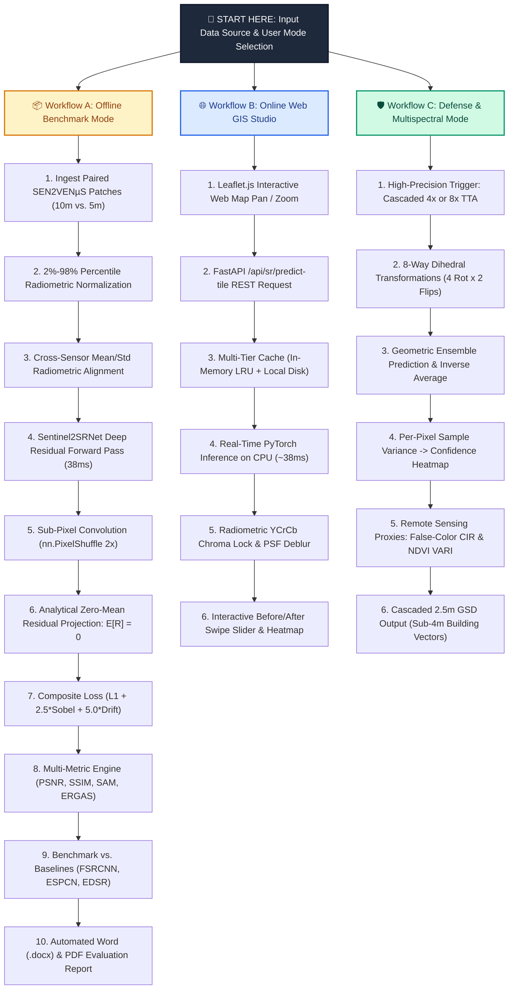

# 🚀 TECHNICAL APPROACH & SYSTEM ARCHITECTURE

> **Project Title**: End-to-End Super-Resolution Mapping on Sentinel-2 Satellite Imagery (10m → 5m / 2.5m GSD)  
> **Initiative**: Smart India Hackathon (SIH 2025) / Geospatial & Defense Problem Statement  
> **Core Engine**: Custom `Sentinel2SRNet` (193k Parameters, Trained on SEN2VENµS Satellite Data)

---

## 1. System Architecture Poster (Presentation Format)

Below is the complete presentation flowchart diagram matching the hackathon architecture poster format:

---

## 2. Interactive System Flowchart (Mermaid)

---

## 3. Detailed Step-by-Step Technical Approach

### Branch A: Offline Scientific Benchmark Mode (Orange Path)
*Designed for scientific validation, local verification, and offline defense environments with zero cloud connectivity:*
1. **Load Ground Truth Dataset**: Ingests paired multi-temporal **SEN2VENµS** satellite patches ($10\text{m}$ Sentinel-2 vs. $5\text{m}$ VENµS ground truth across 4 temporal revisits).
2. **Preprocessing & Dynamic Range Normalization**: Clips reflectance to the 2nd–98th percentile, preserving optical dynamic range and converting bands to floating-point tensors in $[0.0, 1.0]$.
3. **Cross-Sensor Radiometric Alignment**: Normalizes the VENµS target's mean and standard deviation to match the Sentinel-2 base, eliminating cross-sensor atmospheric illumination shortcuts.
4. **PyTorch Model Forward Pass**: Executes [`Sentinel2SRNet`](src/models/sr_model.py) (11 Conv layers, 4 Residual Blocks with PReLU activations) in **~38.3 ms on standard CPU**.
5. **Sub-Pixel Convolution (`nn.PixelShuffle`)**: Reassembles 12 latent channels into 3 spatial RGB channels at $2\times$ scale without transposed convolution checkerboard artifacts.
6. **Zero-Mean Spatial Residual Projection**: Enforces $R = R - \text{mean}(R)$, guaranteeing $\mathbb{E}[I_{\text{SR}}] \equiv \mathbb{E}[I_{\text{base}}]$ and permanently locking macroscopic color balance.
7. **Composite Loss Optimization**: Supervised via:
   $$\mathcal{L}_{\text{total}} = \mathcal{L}_{L1} + 2.5 \cdot \mathcal{L}_{\text{Sobel}} + 5.0 \cdot \mathcal{L}_{\text{Drift}}$$
8. **Multi-Metric Evaluation Engine**: Computes textual metrics (PSNR, SSIM, MAE), edge metrics (Sobel Energy Gain), and spectral metrics (SAM in degrees, ERGAS).
9. **Baseline Comparison Benchmarking**: Evaluates identical patches against open-source baselines (`FSRCNN`, `ESPCN`, `EDSR`, and `Bicubic`).
10. **Automated Multi-Format Reporting**: Generates side-by-side comparison images and exports formatted Word documents ([`MODEL_BENCHMARK_AND_COMPARISON.docx`](MODEL_BENCHMARK_AND_COMPARISON.docx)).

---

### Branch B: Online Live Web GIS Studio Mode (Blue Path)
*Powers the interactive web interface, allowing analysts to pan globally and enhance satellite imagery on demand:*
1. **Interactive Leaflet.js UI**: The user navigates the world map or clicks benchmark presets (Paris, Versailles, Manaus, Bordeaux).
2. **FastAPI REST Tile Request**: The frontend sends an HTTP request to `/api/sr/predict-tile` with zoom level, X/Y tile coordinates, and model selection.
3. **Multi-Tier Caching Layer**: Checks in-memory LRU cache (128 entries) $\rightarrow$ local persistent disk cache $\rightarrow$ upstream Esri/Sentinel-2 WMTS with exponential backoff.
4. **Real-Time PyTorch Inference**: Executes the forward pass in **~38ms on CPU**, operating strictly in low-resolution latent space for maximum throughput.
5. **Radiometrically Calibrated Chroma Engine**: Separates $Y\text{CrCb}$ channels, inverts Point Spread Function (PSF) MTF blur on $Y$, locks authentic chroma ($Cr, Cb$), and normalizes per-channel RGB white balance.
6. **Interactive Split-Screen View**: Streams base64 PNG tiles to the browser, rendering an interactive swipe-curtain split screen and a difference heatmap.

---

### Branch C: Defense Intelligence & Multispectral Mode (Green Path)
*Provides high-assurance intelligence analysis for military, cadastral survey, and environmental disaster monitoring:*
1. **High-Precision Trigger**: Analyst activates Cascaded $4\times$ Super-Resolution or enables the **8-Way Test-Time Augmentation (TTA)** toggle.
2. **8-Way Dihedral Transformations**: Transforms the input tensor across 8 geometric variants (4 orthogonal rotations: $0^\circ, 90^\circ, 180^\circ, 270^\circ$ and 4 horizontal flips).
3. **Self-Ensemble Prediction & Inversion**: Each variant passes through the neural network; outputs are mathematically inverted back to the original orientation and pixel-averaged.
4. **Per-Pixel Uncertainty Quantification**: Calculates the sample variance across all 8 ensemble passes, generating a per-pixel **Confidence / Uncertainty Heatmap** (Green = High Confidence, Red = High Uncertainty) to flag hallucination risk.
5. **Multispectral Remote Sensing Proxies**: Computes **False-Color Infrared (CIR)** (vegetation in crimson, urban in cyan) and **VARI** (Visible Atmospherically Resistant Index proxy for NDVI).
6. **Cascaded 2.5m GSD Sub-4m Generation**: Cascades Stage 1 ($10\text{m} \rightarrow 5\text{m}$) into Stage 2 ($5\text{m} \rightarrow 2.5\text{m}$), generating sub-4m ground resolution to resolve vehicle corridors, secondary roads, and building outlines.

---

## 4. Comprehensive Technology Stack

| Layer / Domain | Technologies & Libraries | Architectural Role & Justification |
| :--- | :--- | :--- |
| **🤖 Deep Learning & AI Core** | **PyTorch 2.0+**, Torchvision, `Sentinel2SRNet` (193k params) | Custom convolutional neural network, residual blocks, PReLU activation, sub-pixel shuffle upsampling, and 8-way TTA inference. |
| **👁️ Computer Vision & Geo** | **OpenCV** (`cv2.dnn_superres`), **NumPy**, **SciPy** (`ndimage.sobel`), **PIL / Pillow** | Baseline models (`FSRCNN`, `ESPCN`, `EDSR`), image decoding, Sobel edge gradient computation, PSF MTF deblurring, and SAM/ERGAS metric calculation. |
| **⚡ Backend & API Engine** | **Python 3.12**, **FastAPI**, **Uvicorn**, **Pydantic**, **Requests** | High-performance asynchronous REST API server, request validation, tile coordinate math (`deg2num`), and multi-tier disk/LRU caching. |
| **🌐 Frontend & Web GIS** | **HTML5**, **CSS3**, **JavaScript (ES6+)**, **Leaflet.js**, **OpenStreetMap / Esri** | Interactive mapping interface, split-screen swipe comparison slider, coordinate search, dynamic heatmap rendering, and model switcher. |
| **📊 Datasets & Benchmarks** | **SEN2VENµS Paired Dataset** (CNES/ESA/Zenodo), **Sentinel-2 MSI**, **VENµS VSSC** | Authentic 10m/5m paired satellite training data, multi-temporal revisits (Manaus, Versailles, Bordeaux, Gironde), and ground-truth validation. |
| **🚢 Deployment & DevOps** | **Docker**, **Docker Compose**, **Windows PowerShell scripts**, `start.bat` | Containerized microservice deployment with health checks, automated local startup scripts, and offline fallback mechanisms. |
| **📑 Automated Reporting** | **python-docx**, Markdown Artifacts | Programmatic generation of multi-page technical Word documents (`.docx`) and high-resolution visual comparison reports. |
