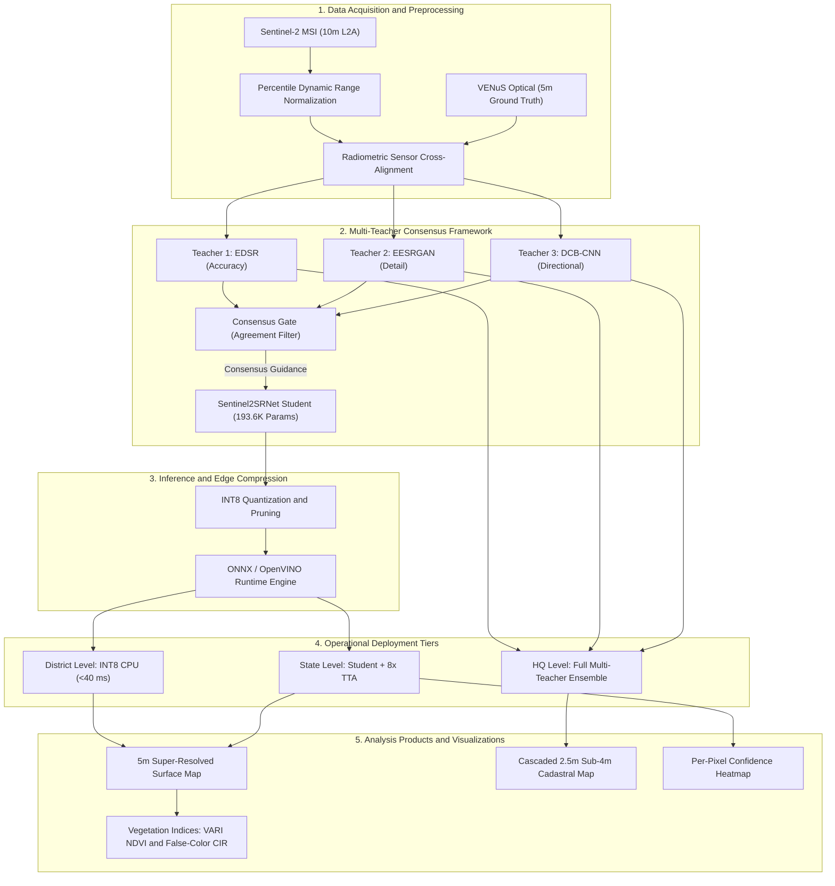

# Technical Approach and System Architecture

Comprehensive overview of the technical approach, system architecture, multi-tiered deployment, and technology stack for the Sentinel-2 Super-Resolution Mapping project developed by Team PixelForge for Smart India Hackathon 2026 (Problem Statement SIH26142, National Technical Research Organisation - NTRO).

---

## 1. Technical Approach: The Seven-Stage Pipeline

Our solution follows a structured, seven-stage engineering pipeline designed to bridge the gap between high-capacity research models and low-resource operational deployment in government district offices:

```text
[1. Collect Paired Photos]
Sentinel-2 (10m) + VENuS (5m) Paired Dataset (3,695 pairs across 3 sites)
           │
           ▼
[2. Test Lightweight Starter Models]
FSRCNN · ESPCN · Sentinel2SRNet
           │
           ▼
[3. Three Expert Models Teach]
Accuracy Expert (EDSR) · Detail Expert (EESRGAN) · Directional Expert (DCB-CNN)
           │
           ▼
[4. Small Student Model Learns]
Consensus Knowledge Distillation -> Sentinel2SRNet Student (Copies consensus-only detail)
           │
           ▼
[5. Shrink to Fit Any PC]
Pruning · INT8 Quantization · ONNX + OpenVINO Runtime
           │
           ▼
[6. Delivered to Every Government Level]
District: INT8 Student (CPU) | State: Student + 8x TTA | Headquarters: Full 3-Teacher Ensemble
           │
           ▼
[7. Sharper, Trustworthy Maps]
Cascaded 2.5m GSD Maps + Per-Pixel Confidence Heatmaps (Green=High, Red=Uncertain)
```

### Detailed Breakdown of the Seven Stages:

1. **Collect Paired Satellite Imagery**:
   We train on authentic paired multispectral imagery from the European Space Agency and CNES: 10-meter Sentinel-2 inputs paired with non-interpolated 5-meter VENuS ground truth. The dataset encompasses 3,695 paired scenes across three distinct biomes (dense rainforest in Manaus, coastal wetlands in Mar Menor, and urban/agricultural plains in Alsace).
2. **Test Lightweight Starter Models**:
   Early experimentation evaluated baseline CNN architectures (FSRCNN and ESPCN) alongside an initial prototype of Sentinel2SRNet to establish CPU latency and reconstruction baselines.
3. **Deploy Three Teacher Experts**:
   To guide the learning process without human annotation:
   * **EDSR (Accuracy Expert)**: Preserves overall pixel intensity distributions and avoids geometric skew.
   * **EESRGAN (Detail Expert)**: Utilizes second-order Laplacian edge supervision to reconstruct crisp road margins and building outlines.
   * **DCB-CNN (Directional Expert)**: Employs frequency-separable directional convolutions (1x3 and 3x1 kernels) to maintain continuous linear corridors like roads and shorelines.
4. **Consensus Knowledge Distillation**:
   A primary risk of generative super-resolution is hallucination (inventing nonexistent structures). Our distillation objective filters out synthetic details by allowing the student model (Sentinel2SRNet) to learn high-frequency features only where all three teacher models agree.
5. **Model Compression for Edge Execution**:
   The student model is pruned and quantized to INT8 precision. Using ONNX and OpenVINO runtime engines, it executes with minimal memory footprint on non-GPU systems.
6. **Multi-Tier Deployment Architecture**:
   Recognizing the diverse compute infrastructure across government echelons:
   * **District Offices**: Pocket version (INT8 student model on standard dual-core or quad-core desktop CPUs, under 40 ms per tile).
   * **State Agencies**: Standard version (student model running with 8x Test-Time Augmentation to produce calibrated uncertainty heatmaps).
   * **National Headquarters**: High-precision version (full multi-teacher ensemble executed on GPU servers for mission-critical analysis).
7. **Trustworthy Mapping and Uncertainty Scoring**:
   Super-resolved maps are delivered alongside an epistemic confidence map, where green denotes high model certainty and red flags ambiguous features, preventing incorrect decision-making.

---

## 2. Radiometric-Safe Reconstruction Pipeline

To ensure that super-resolution does not corrupt authentic multispectral reflectance values used in scientific indices like NDVI and NDWI:

```text
RGB Input (10m) ──> [ YCrCb Color Transform ] ──┬──> Y (Luminance Channel) ──> [ Sentinel2SRNet ] ──> Enhanced Y' ──┐
                                                 │                                                                   │
                                                 └──> Cr, Cb (Chroma Channels) ──> [ Exact Chroma Lock ] ────────────┴──> Reconstructed RGB (5m / 2.5m)
```

1. **Luminance Separation**: The input image is converted from RGB to YCrCb space.
2. **Targeted Enhancement**: Spatial super-resolution is executed strictly on the luminance channel (Y), where human and analytical edge acuity resides.
3. **Chroma Locking**: The original chrominance channels (Cr, Cb) are preserved and locked, preventing artificial color shifting.
4. **Zero-Mean Residual Projection**: The learned residual map has its spatial mean analytically subtracted, guaranteeing zero macro-illumination drift.

---

## 3. System Architecture Diagram



---

## 4. Technology Stack

The project relies on a lightweight, modular technology stack:

* **Programming Language**: Python (3.10, 3.11, 3.12).
* **Deep Learning Frameworks**: PyTorch, Torchvision, ONNX Runtime, OpenVINO.
* **Computer Vision and Scientific Computing**: OpenCV (opencv-contrib-python), NumPy, SciPy, Pillow, Scikit-Image, Matplotlib.
* **Backend and API Layer**: FastAPI, Uvicorn, Pydantic, HTTPX, Requests.
* **Web Mapping and Frontend**: HTML5, CSS3, Vanilla JavaScript (ES6+), Leaflet.js, Esri World Imagery API.
* **DevOps, Tooling and Packaging**: Docker, PyTest, Git.

---

## 5. Quantitative Model Benchmark (740 Test Patches)

Comprehensive evaluation conducted across all 740 unseen test patches from the SEN2VENuS dataset evaluated against authentic 5m VENuS ground truth:

| Model Architecture | Checkpoint File | MSE (Lower is better) | PSNR (dB) (Higher is better) | SSIM (Higher is better) | Delta PSNR vs Bicubic (dB) | Delta SSIM vs Bicubic |
| :--- | :--- | :---: | :---: | :---: | :---: | :---: |
| **Bicubic (Baseline)** | *Interpolation reference* | 338.39 | 23.79 dB | 0.7628 | Baseline | Baseline |
| **DCBCNN (DCB-RCAB)** | `slimdiffsr_sentinel2_2x_best.pt` | 244.79 | 25.15 dB | 0.7769 | +1.36 dB | +0.0141 |
| **EESRGAN** | `eesrgan_sentinel2_2x_best.pt` | 246.57 | 25.05 dB | 0.7745 | +1.26 dB | +0.0117 |
| **EDSR** | `edsr_sentinel2_2x_best.pt` | 257.87 | 24.92 dB | 0.7845 | +1.13 dB | +0.0217 |
| **Sentinel2SRNet (Student)** | `sr_sentinel2_2x_best.pt` | 265.02 | 24.85 dB | **0.7898** | +1.06 dB | **+0.0270** |
| **ESPCN** | `espcn_sentinel2_2x_best.pt` | 278.95 | 24.59 dB | 0.7746 | +0.80 dB | +0.0118 |
| **FSRCNN** | `fsrcnn_sentinel2_2x.pt` | 338.20 | 23.51 dB | 0.7122 | -0.28 dB | -0.0506 |
